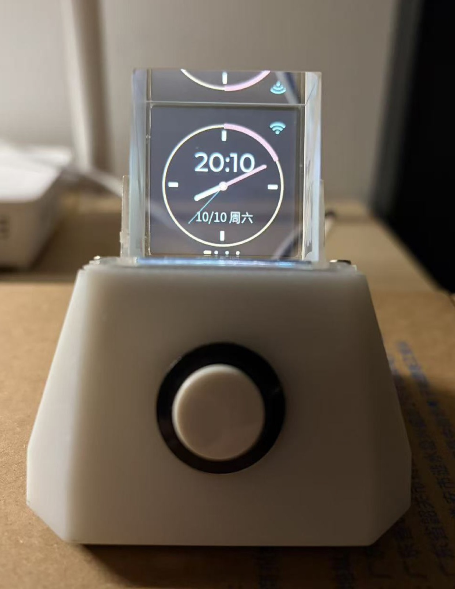
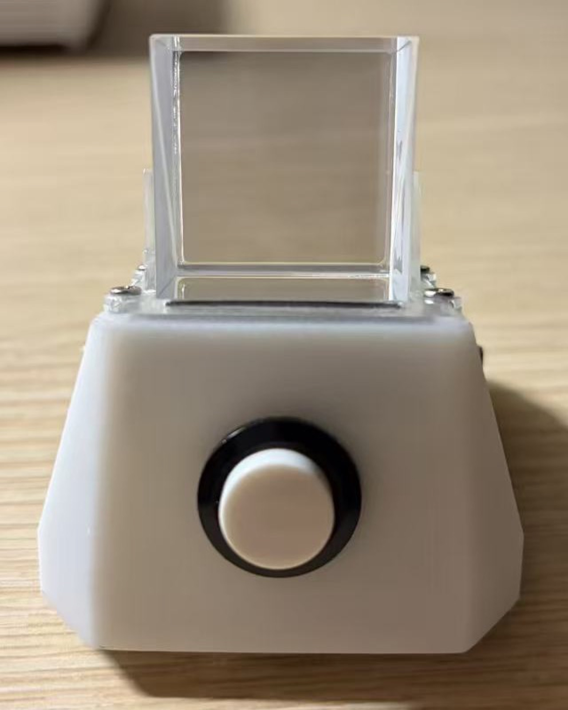
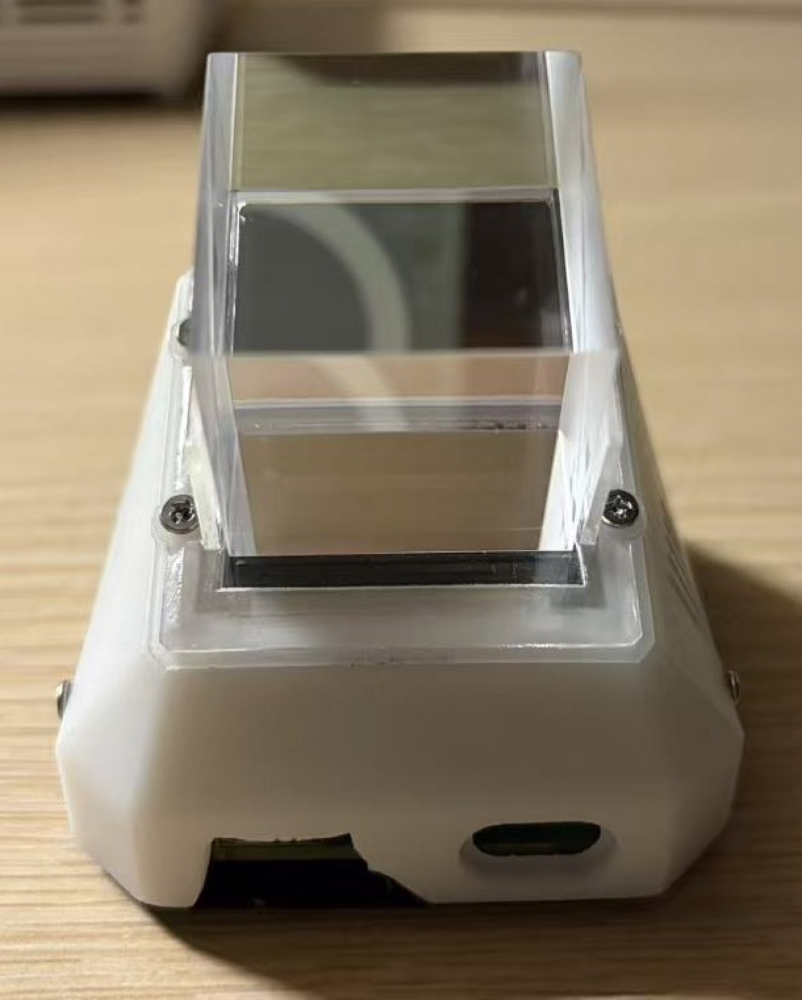
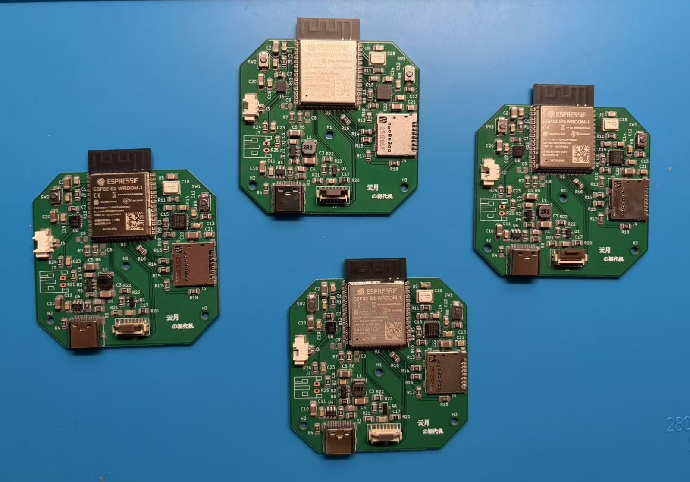
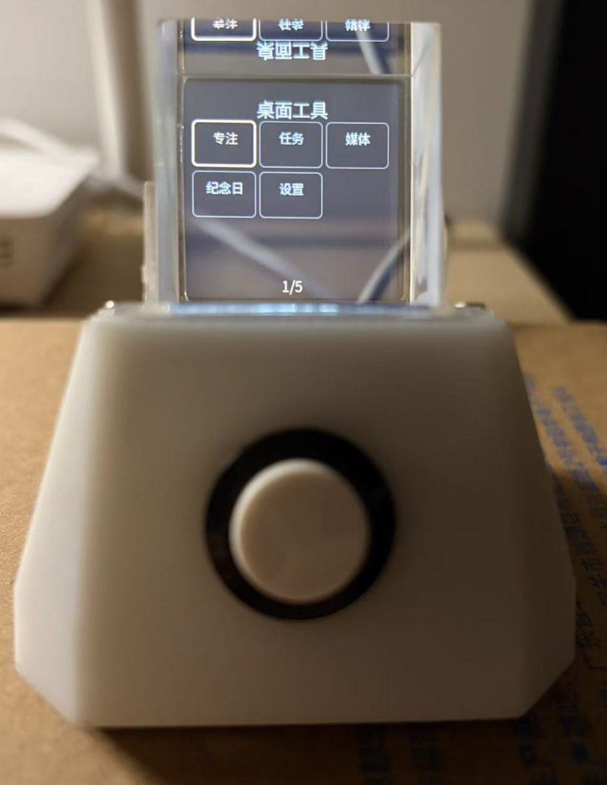
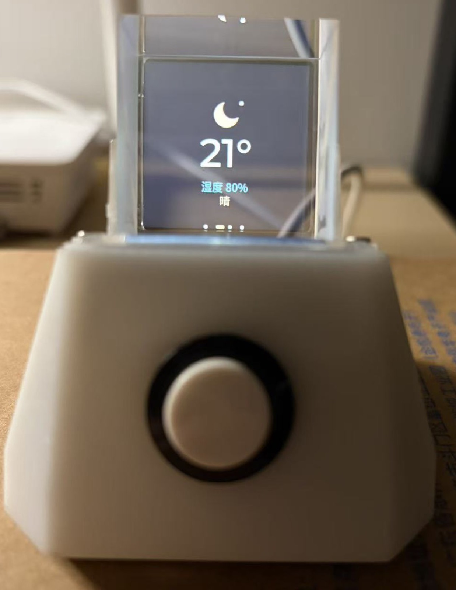
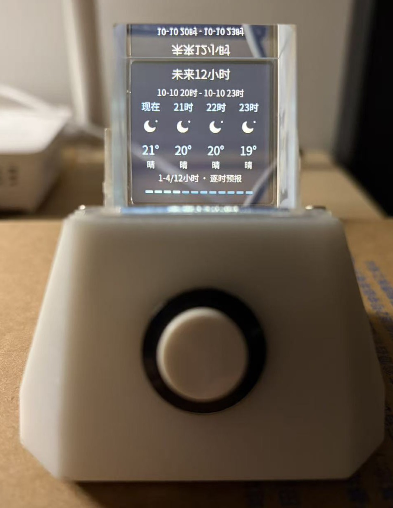
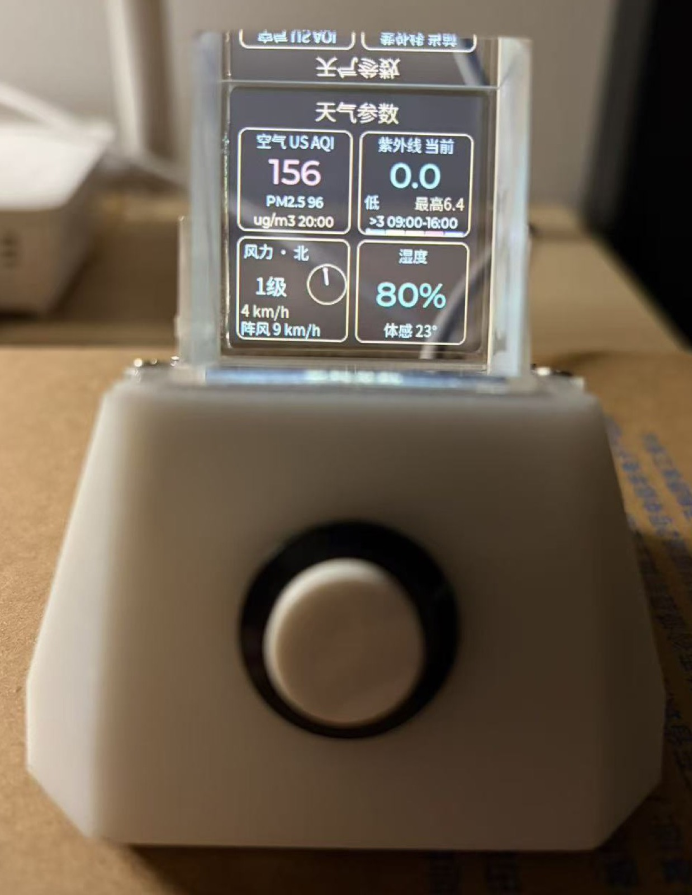
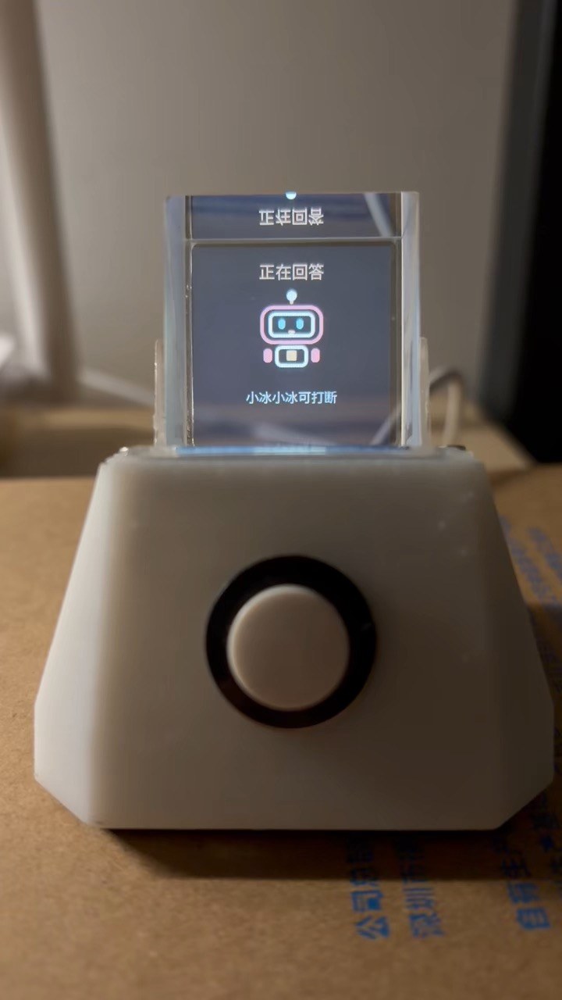
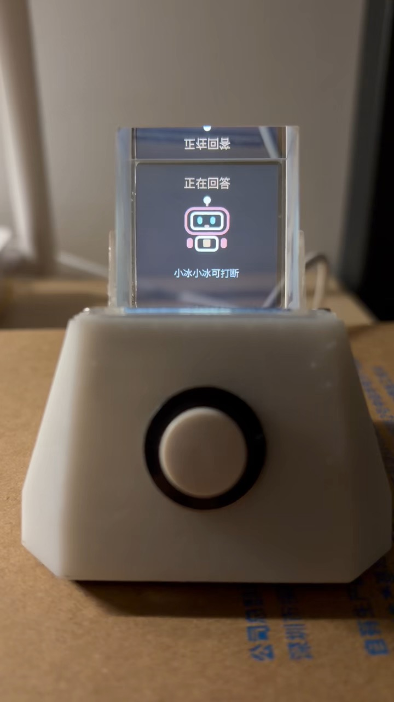

# VoxConductor | Prism-display desktop voice assistant

[简体中文](README.md) · [English](README.en.md) · [Chinese mirror](README.zh-CN.md)

VoxConductor is an ESP32-S3 desktop voice assistant with a custom PCB, a screen and beam-splitting prism, a microphone, a speaker, buttons, and motion input. The device handles its interface, audio, tool execution, and local records, and connects directly to cloud services for ASR, model responses, and TTS.

The prism reflects the screen’s two-dimensional image to create a floating appearance.

  

Updated: 2026-11-03. [Current progress](docs/PROGRESS.md) · [Validation](docs/SYNC_VALIDATION.md) · [Development history](DEVELOPMENT_HISTORY.en.md).

## Hardware

The 52 × 50 mm four-layer PCB uses an ESP32-S3-WROOM-1, a 240 × 240 ST7789-family display, an INMP441 microphone, a MAX98357A I2S amplifier, and an MPU motion sensor. Input is handled through physical buttons and tilt; firmware uses ESP-IDF / FreeRTOS and LVGL 9.

  
  
  
  

The [hardware project](hardware/README.md) contains KiCad, fabrication, and V3-SLA mechanical files. The [board BOM](hardware/BOM.md) lists 61 component positions.

## Software features

| Area | Implemented in the current code |
| --- | --- |
| Desktop and weather | Clock, wallpapers, brightness and orientation; current weather, 12-hour forecast, UV, US AQI / PM2.5, wind, and humidity |
| Voice and tools | Local “小冰小冰” wake word, push-to-talk, follow-up turns, and cancellation; time/weather queries, volume/home settings, and bounded tool calls |
| Daily tools and media | Alarms, reminders, to-dos, notes, countdowns, and Pomodoro; SD music/ambient audio/wallpapers and a LAN management page |
| Records and recovery | Bounded recent context, memory with provenance and expiry, history search and deletion; SD text records and two checksummed snapshot slots |

  
  
  
  

## Voice flow

1. A button or WakeNet starts capture; 16 kHz real-time ASR returns a transcript.
2. Exact local commands run directly; other questions enter a bounded model/tool loop. Example configuration uses Qwen ASR/TTS and DeepSeek.
3. The device validates arguments and confirmation rules, then returns actual execution results to the model.
4. After releasing the model connection, it opens a 24 kHz TTS session and plays audio through I2S. Successful turns then commit context and wait for another utterance within the follow-up window.

Model-proposed reminders and notes remain candidates until the next-turn exact command “确认执行” (confirm). “查看任务保存状态” reads disk snapshots; “重试任务保存” reconciles by stable task ID, restores runtime state, and requests confirmation again for candidates awaiting storage. “取消执行” clears pending and retry authorization.

## Progress and remaining work

Development sources and host tests are synchronized; the firmware currently provides a Chinese UI and coordinates capture and playback by turn.

| Status | Evidence and next steps |
| --- | --- |
| Demonstrations | Two videos from 2026-10-10 show basic queries and volume control; October 11 device and weather photos record device state and online service data at capture time |
| Offline checks passed | On 2026-11-03, five Agent host-test groups, task snapshot reconciliation/reload, and three source-contract checks passed, using mocks, virtual clocks, and fault injection |
| Build record | A local ESP32-S3 build passed on 2026-10-25; rebuilding and flashing the November 3 sync branch remain pending |
| Operating prerequisites | Cloud queries require internet access and your own service credentials; supply a legally usable 24 kHz, 16-bit little-endian mono `firmware/main/reminder.pcm`; match Flash/PSRAM settings to the physical board |
| Execution and privacy | Device actions with unknown outcomes await user inspection and reconciliation; task reconciliation deduplicates writes by stable ID; cancellation or process reload invalidates confirmation and retry authorization, so execution requires renewed confirmation; SD conversations are plain text, while credentials, reminder audio, and private records stay local |
| Hardware revisions | KiCad retains the pre-repair J2 design, pending the physical correction and design review; V3-SLA awaits printed fit testing; complete assembly procurement needs items beyond the board BOM |
| Device acceptance pending | Validate waking and interruption across distance, pronunciation, and noise, plus echo control, playback continuity, web upload/save and voice contention, SD power-loss recovery, memory peaks, and end-to-end latency |
| Measurements and plans | Recognition accuracy, wake-word success, latency, and long-term stability await controlled statistical tests; multi-device action previews, capability registration, multi-day task continuation, and controllable proactive reminders await implementation |

The 180-second software budget constrains turn processing; SD synchronization and driver-cleanup tail latency, hard real-time behavior, and full-duplex stability await dedicated validation. Review provider availability, costs, and data terms when using cloud services.

## Demonstration videos

| Wake word, time and weather queries · about 26 s | Voice volume control · about 29 s |
| --- | --- |
|  |  |

The question audio is pitch-shifted; the original visual sequence and duration are retained. [Video processing record](docs/videos/2026-10-10/README.md) · [Showcase](docs/SHOWCASE.md).

## Documentation and reproduction

The target is ESP32-S3 / ESP-IDF 6.0.2, with component versions in `firmware/dependencies.lock`. Follow [setup](docs/DEVICE_CLOUD_VOICE.md), create local configuration from templates such as the [Wi-Fi example](firmware/main/wifi_credentials.example.h), prepare the reminder PCM, then run `idf.py build` in `firmware`.

| Entry | Contents |
| --- | --- |
| [Documentation index](docs/README.md) | Full documentation directory |
| [Hardware design and assembly](docs/HARDWARE_DESIGN.md) / [Wiring](docs/HARDWARE_V1.md) | PCB, components, GPIO, and mechanical boundaries |
| [Technical architecture](docs/TECHNICAL_ARCHITECTURE.md) / [Voice and memory](docs/VOICE_DIALOGUE_AND_MEMORY_PLAN.md) | Pipeline, resources, execution, and persistence |
| [Features and pages](docs/FEATURES.md) / [Desktop interaction](docs/DESKTOP_TOOLS_AND_GAMES.md) | Pages and controls |
| [Web management](docs/WEB_MANAGEMENT_DESIGN.md) | Interfaces and acceptance steps |
| [Roadmap](docs/ROADMAP.md) / [Publication checklist](docs/GITHUB_PUBLICATION_CHECKLIST.md) | Priorities and publication scope |
| [Historical V1 architecture](docs/ARCHITECTURE.md) / [Earlier validation](docs/DEMO_AND_VERIFICATION.md) | Earlier FastAPI architecture and validation records |

## License and attribution

The project-authored software and original technical documentation identified in [License scope](LICENSE_SCOPE.md) and its inventories use the [MIT License](LICENSE), permitting commercial use, modification, and redistribution subject to retaining copyright and permission notices. For `hardware/**` (including mechanical scripts), dependencies, fonts, images, audiovisual material, and data, follow [Third-party notices](THIRD_PARTY_NOTICES.md) and their applicable terms.

Weather and air quality use Open-Meteo; air-quality sources include CAMS. See the [data-service documentation](https://open-meteo.com/en/docs/air-quality-api). ESP-IDF, LVGL, ESP-SR, cloud services, and third-party media have their own terms; music attribution remains with the media pack.
