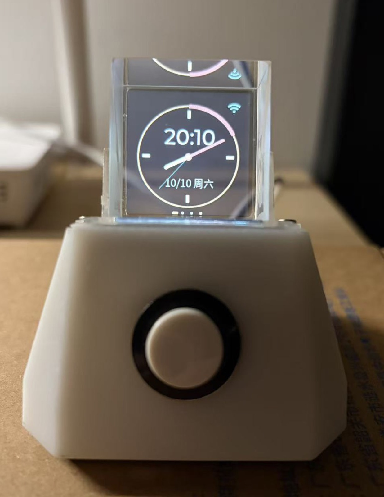
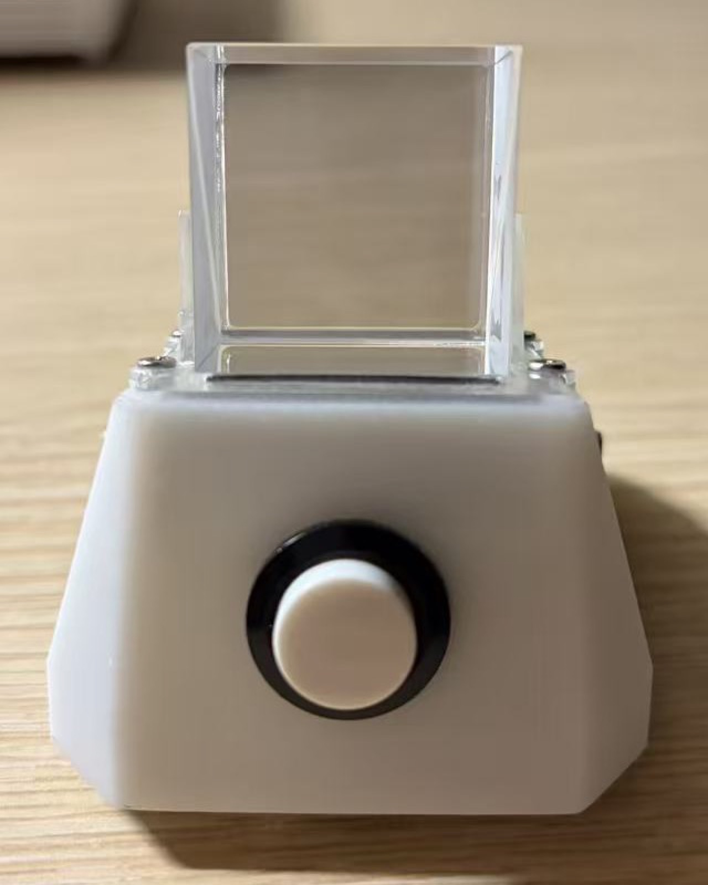
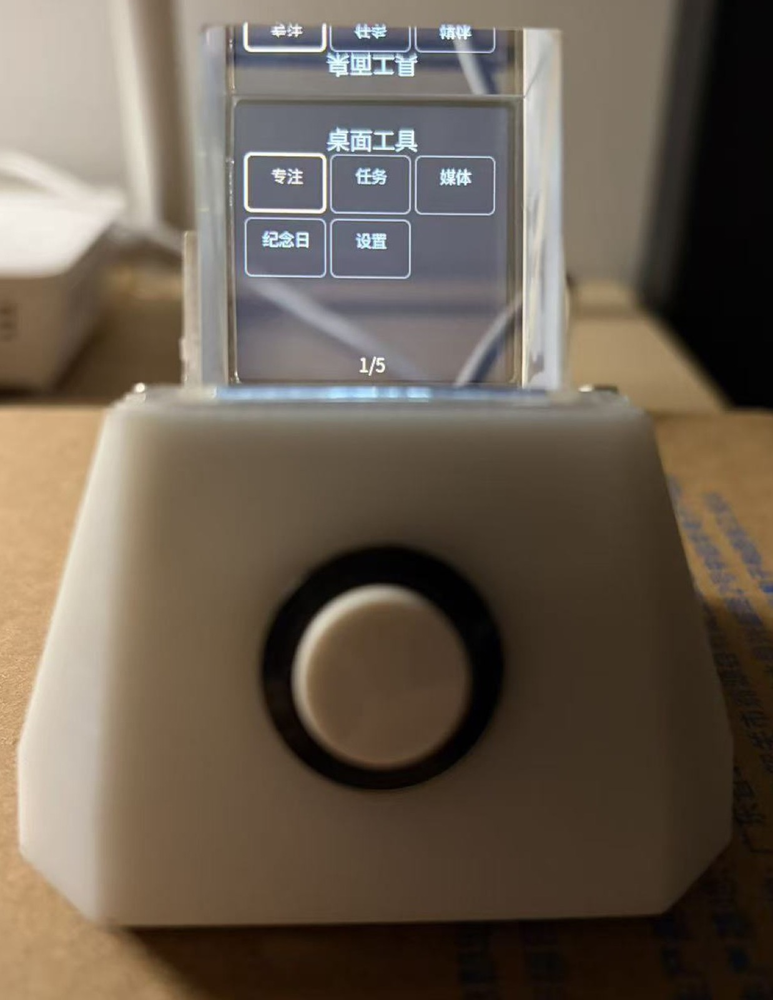

# VoxConductor

[简体中文](README.md) | [English](README.en.md)

VoxConductor is an ESP32-S3 desktop voice assistant that combines a custom PCB, a prism display, audio input and output, physical controls, motion interaction, and cloud voice services. The device handles its interface, audio capture and playback, local tools, and local records. Speech recognition, language-model responses, and speech synthesis run in the cloud.

The display appears to float inside the prism, but it is a two-dimensional image. The firmware interface is currently Chinese-only; the repository does not provide an English UI or a language switch.

## What it does

- Shows the time and weather, and provides pages for alarms, media, focus tools, and settings.
- Supports voice queries and selected device actions through tools handled on the device.
- Uses physical buttons and an inertial sensor for interaction; it does not rely on a touchscreen.
- Runs the main interaction on the device without a PC-hosted FastAPI service.
- Includes a KiCad hardware project, manufacturing files, a board-level bill of materials, and mechanical design files.

Voice features require an internet connection and credentials for the configured cloud services. VoxConductor is not an offline language-model device. The existing demonstrations show individual queries and a volume-control interaction; they do not measure wake-word success, latency, or long-term reliability.

## Device photos








Additional images and demonstration videos are collected in [Showcase](docs/SHOWCASE.md). The question audio in the full demonstration videos has been pitch-shifted. They are edited demonstrations, not untouched recordings or statistical tests.

## Hardware

The active hardware project is in the hardware directory. It includes the KiCad schematic and PCB, fabrication outputs, project libraries, and V3-SLA mechanical files. The board is 52 × 50 mm and four-layer. The board BOM covers 61 component positions; it is not a complete bill of materials for the whole assembled device.

There are known revision boundaries to review before fabricating or printing:

- The physical J2 screen connector was repaired on the assembled device, but that repair has not yet been written back to the current KiCad design.
- The V3-SLA enclosure has passed CAD checks, but its resin-printed fit, cable bends, and thread strength still need physical validation.

Start with [Hardware design and assembly](hardware/README.md) and [Hardware design notes](docs/HARDWARE_DESIGN.md). Do not treat the current design files as a newly verified production revision.

## Architecture and documentation

- [Technical architecture](docs/TECHNICAL_ARCHITECTURE.md)
- [Feature overview](docs/FEATURES.md)
- [Device-direct voice setup](docs/DEVICE_CLOUD_VOICE.md)
- [Roadmap](docs/ROADMAP.md)
- [Showcase and media notes](docs/SHOWCASE.md)

The repository also keeps material from an earlier V1 server-based architecture for historical reference. The current device-direct voice flow does not require that server to run on a PC.

## Using an existing device

1. Power on the device and connect it to a 2.4 GHz Wi-Fi network.
2. Wait for network time synchronization. Weather requires internet access; it is an online service, not a measurement from an onboard environmental sensor.
3. For a voice query, use the device's configured push-to-talk or wake-word interaction and wait for the listening state before speaking.
4. Cloud voice queries require working ASR, model, and TTS service configuration. Keep Wi-Fi and provider credentials in local, ignored configuration files; never commit real credentials or paste them into issue reports.

The repository includes a Wi-Fi placeholder at [firmware/main/wifi_credentials.example.h](firmware/main/wifi_credentials.example.h). Configure cloud service credentials only in the local, ignored files documented for the current firmware, and never commit them. See [Device and cloud voice setup](docs/DEVICE_CLOUD_VOICE.md) for the current configuration context.

The SD-card conversation log is plain text. Use care with personal content and do not upload private conversations, logs, or recordings to public issues.

## Building firmware

The documented target is ESP32-S3. The project uses ESP-IDF 6.0.2 with component versions recorded in firmware/dependencies.lock and project configuration. Use the matching board's flash and PSRAM configuration.

With a compatible ESP-IDF environment, the documented commands are:

```sh
cd firmware
idf.py build
idf.py -p YOUR_SERIAL_PORT flash monitor
```

Replace `YOUR_SERIAL_PORT` with the actual serial device path. Consult the linked device setup and architecture documents before mixing the current firmware with historical V1 server or partition settings.

## Limitations

- Wake-word performance depends on distance, pronunciation, and the acoustic environment.
- Interruption during speech and playback continuity still have reliability limits; the project is not described as stable full-duplex voice.
- The management web interface includes settings and media tools, but upload, save, and voice-busy interactions still require device regression testing.
- A single demonstration does not establish recognition accuracy, latency, wake-word success rate, or long-term stability.
- Cloud model and speech services have their own availability, account, privacy, and pricing terms.

## Contributing

Issues and pull requests are useful for reproducible firmware or documentation problems, hardware-document corrections, and improvements that preserve current device behavior. Include the board revision, toolchain version, and concise reproduction steps when relevant. Do not attach credentials, private logs, conversation records, or third-party media without permission. For hardware or media contributions, identify the source and redistribution terms.

## License

The repository currently uses the [PolyForm Noncommercial License 1.0.0](LICENSE). It permits use only within the terms of that license and is not an OSI-approved open-source license. Third-party libraries, fonts, vendor materials, photos, audio, and video remain subject to their own licenses and terms. Review the applicable notices before reuse.
