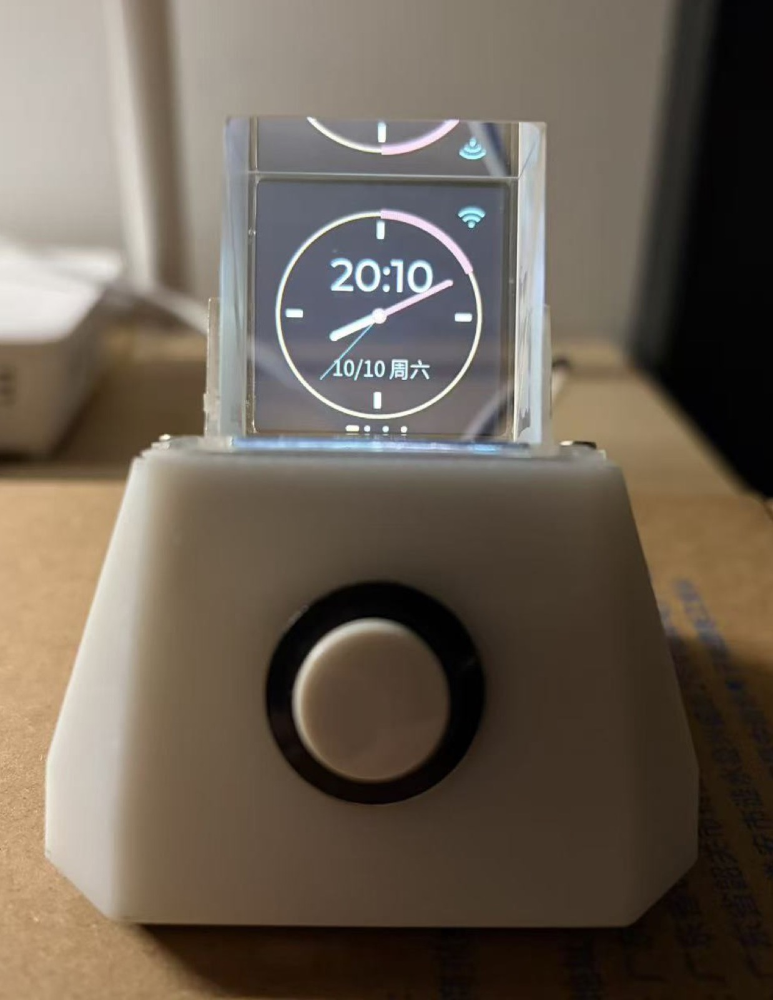
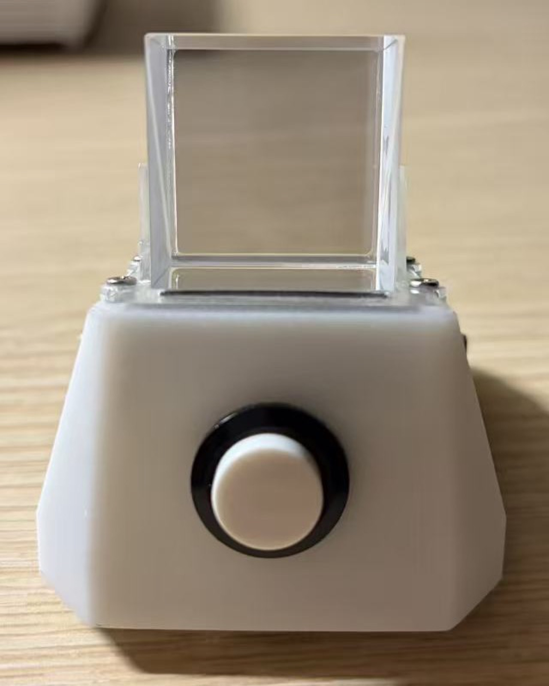
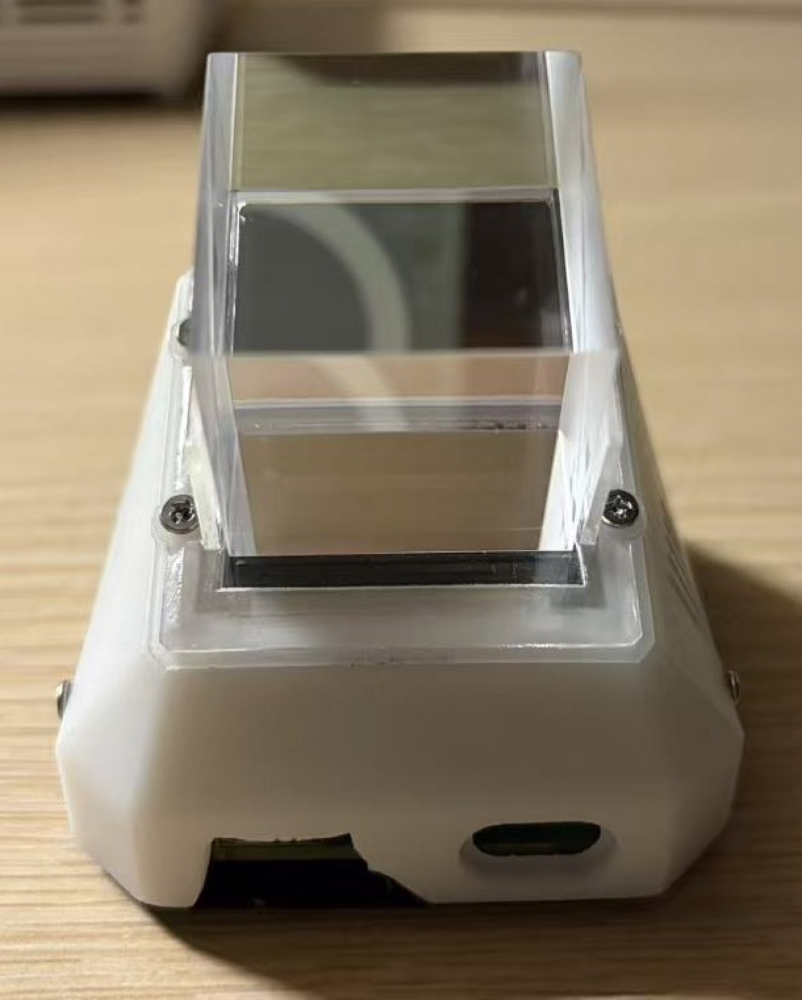
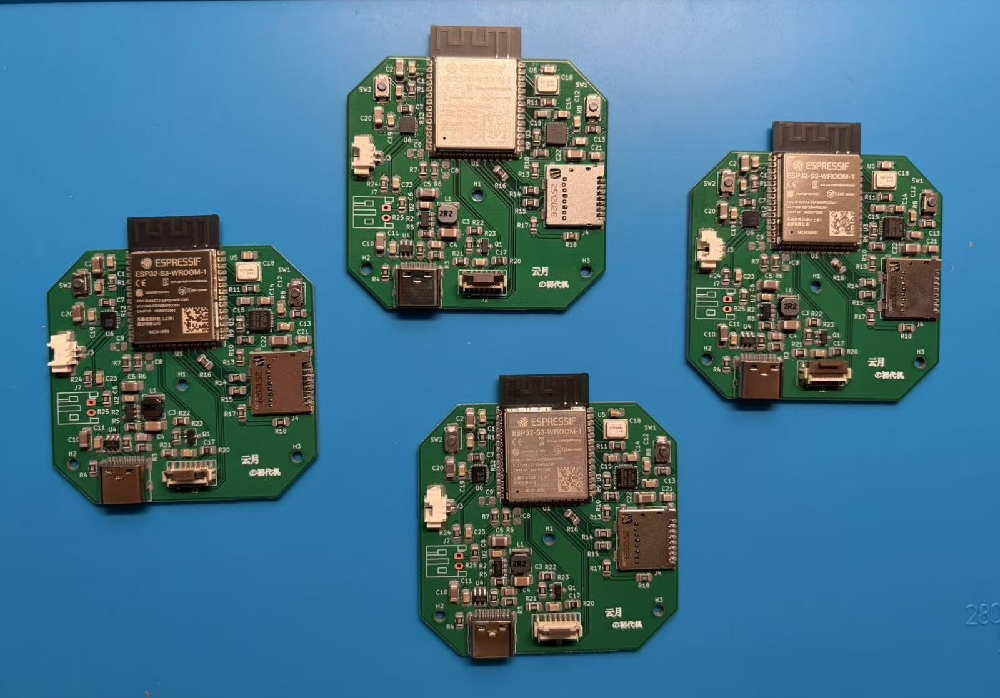
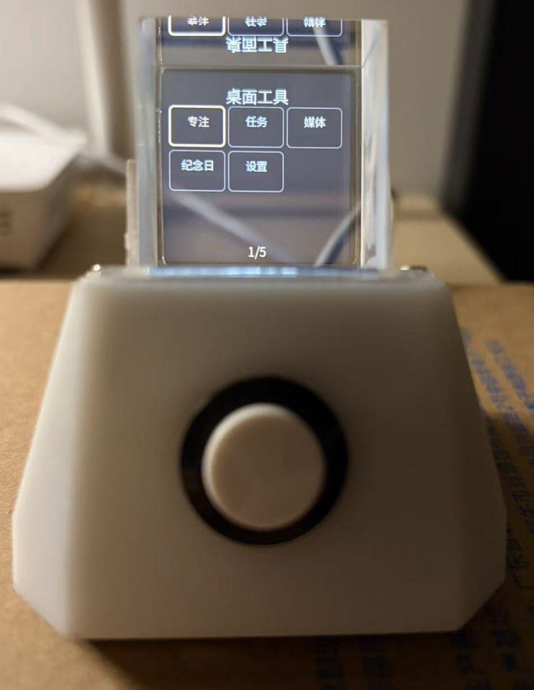
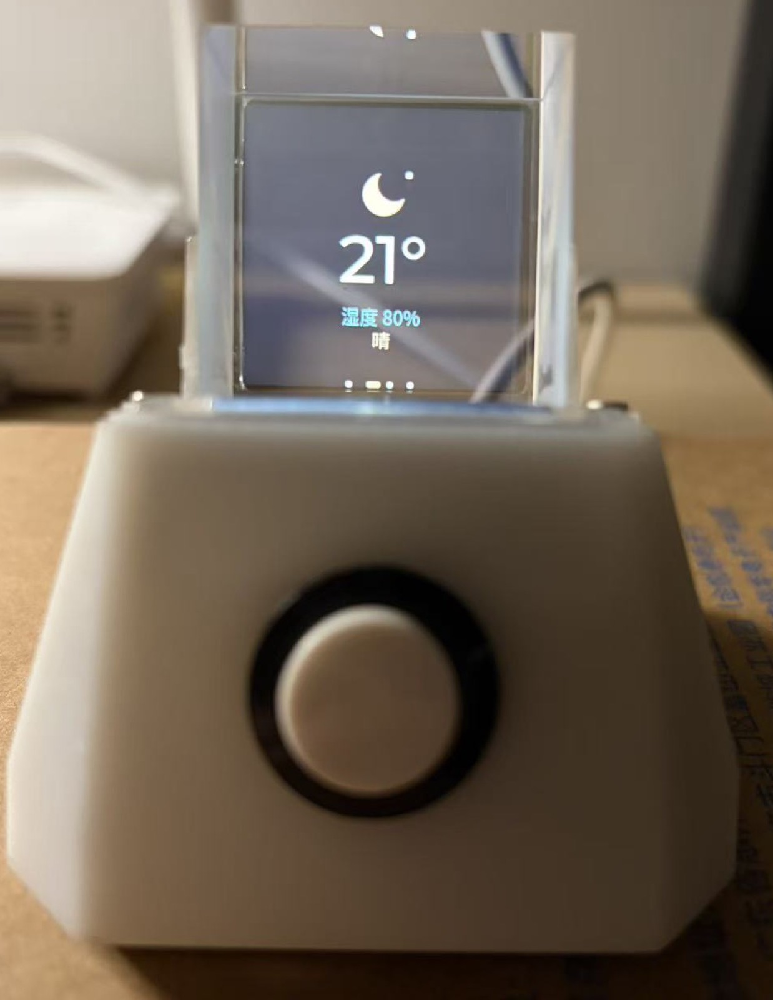
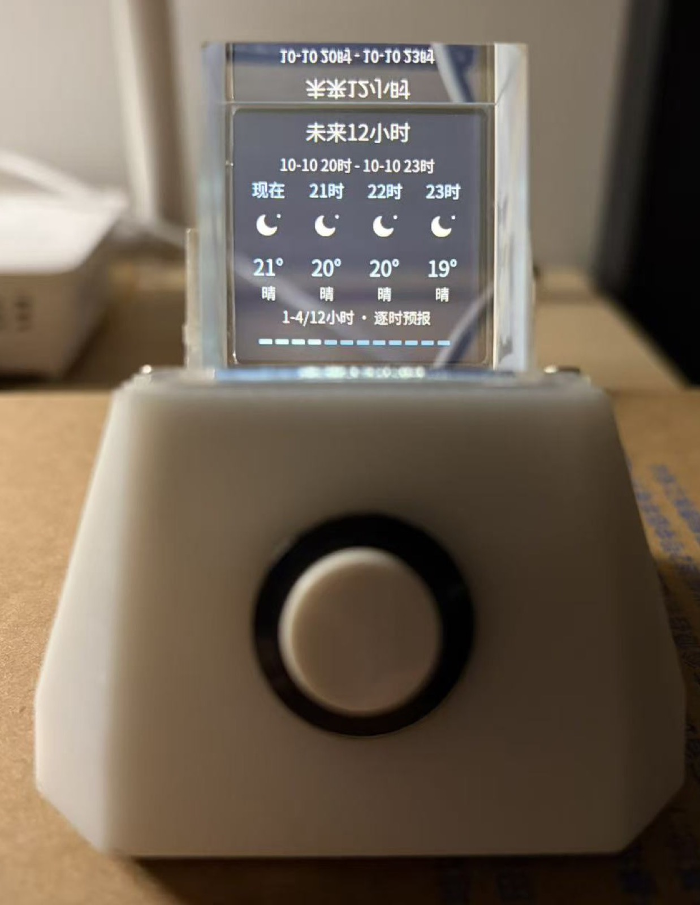
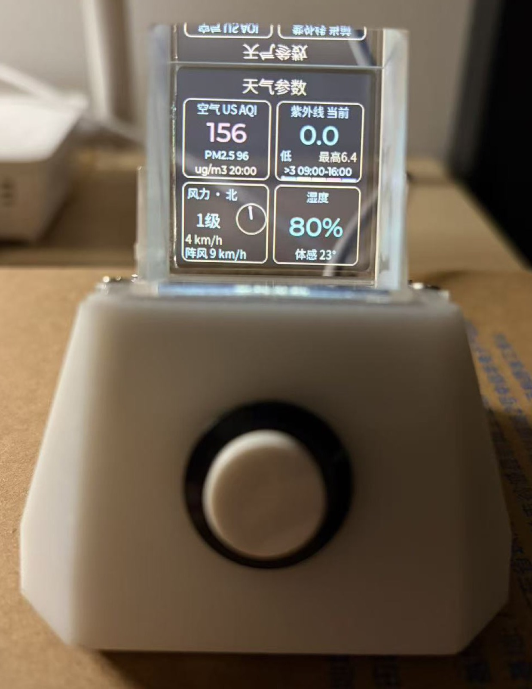
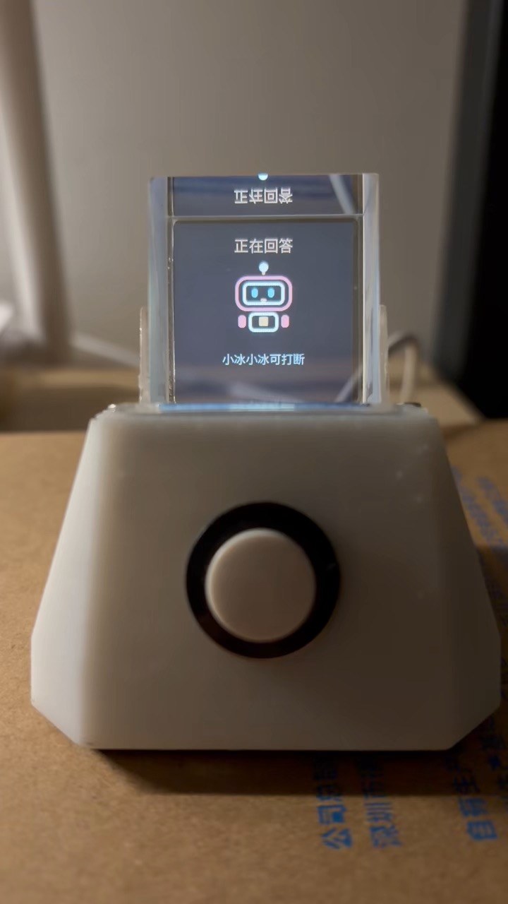
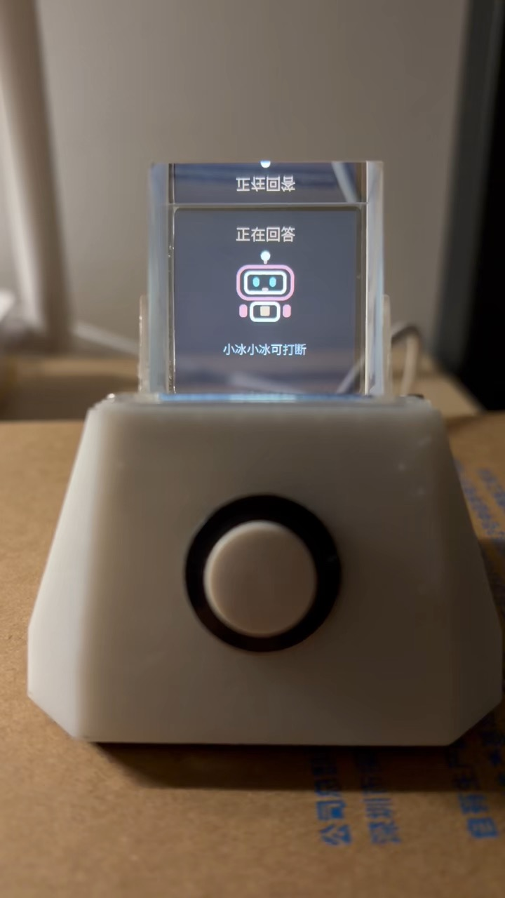

# VoxConductor｜棱镜显示桌面语音助手

[简体中文](README.md) · [English](README.en.md) · [中文副本](README.zh-CN.md)

VoxConductor 是一台基于 ESP32-S3 的桌面语音助手，整合定制 PCB、屏幕与分光棱镜、麦克风、扬声器、按键和姿态交互。设备负责界面、音频、工具执行与本地记录；ASR、模型问答和 TTS 使用云端服务，无需电脑常驻运行服务端。

棱镜呈现的是二维画面的悬浮观感。固件界面目前仅有中文，英文 README 不代表设备支持英文界面。

  

更新：2026-11-03。开发源码与宿主测试已同步；照片和视频保留原拍摄版本。[最新进度](docs/PROGRESS.md) · [验证记录](docs/SYNC_VALIDATION.md) · [开发与维护记录](DEVELOPMENT_HISTORY.md)。

## 硬件

52 × 50 mm 四层 PCB，ESP32-S3-WROOM-1，240 × 240 ST7789 系列显示屏，INMP441 麦克风、MAX98357A I2S 功放及 MPU 姿态传感器。使用实体按键和倾斜操作，不依赖触摸屏；固件基于 ESP-IDF / FreeRTOS 与 LVGL 9。

  
  
  
  

[硬件工程](hardware/README.md) 包含 KiCad、制造和 V3-SLA 结构资料；[板级 BOM](hardware/BOM.md) 覆盖 61 个器件位置，不是整机采购清单。实物 J2 返修尚未写回设计，V3-SLA 仍待打印试装；再次制板前须修订并复核。

## 软件功能

| 方向 | 当前代码能力 |
| --- | --- |
| 桌面与天气 | 时钟、壁纸、亮度与方向设置；当前天气、未来 12 小时预报、UV、US AQI / PM2.5、风与湿度 |
| 语音与工具 | 本地“小冰小冰”唤醒、按键说话、连续接话与取消；时间/天气查询、音量/主页设置及受限工具调用 |
| 日常与媒体 | 闹钟、提醒、待办、备忘录、倒计时、番茄钟；SD 音乐/环境音/壁纸与同网网页管理 |
| 记录与恢复 | 有界近期上下文、带来源和有效期的记忆、历史检索与删除；SD 文字记录和双槽校验快照 |

  
  
  
  

天气来自网络服务，不是板载环境检测；照片中的数值只代表拍摄时刻。上述是代码功能范围，设备可靠性仍按下述验证层级区分。

## 语音流程

1. 按键或 WakeNet 触发采集，16 kHz 实时 ASR 返回转写。
2. 本地精确命令直接处理；其他问题进入有限模型工具循环。示例配置使用 Qwen ASR/TTS 与 DeepSeek，需网络和自有服务凭据。
3. 设备校验参数与确认条件，执行后将真实结果交回模型；设备动作结果未知时不自动重放。
4. 释放模型连接后建立 24 kHz TTS 会话，通过 I2S 播放；成功轮次结束后提交上下文，并在连续对话窗口等待下一句。

模型提出的提醒和备忘录先形成候选，须下一轮精确“确认执行”。“查看任务保存状态”读取磁盘快照；“重试任务保存”先对账，已有 ID 同步运行态且不重写，未保存事项重新等待确认。“取消执行”清除待确认与重试授权；取消或进程重载不会自动恢复授权。

## 当前进度与待优化项

| 状态 | 依据与范围 |
| --- | --- |
| 已有演示 | 下方视频记录基础查询与音量控制；不代表最新源码的全部行为 |
| 已做离线验证 | 2026-11-03 Agent 五组宿主测试、任务快照对账/重载及三项源码契约检查通过；包含模拟输入、虚拟时钟与故障注入 |
| 构建记录 | 2026-10-25 本地 ESP32-S3 构建通过；11 月 3 日同步分支未重新构建或刷机 |
| 待实机验收 | 唤醒词打断、播报连续性、网页上传/保存与语音争用、SD 断电恢复、内存峰值和端到端延迟 |
| 计划 | 多设备行动预览、能力注册、跨天任务续办与可控主动提醒 |

语音仍需按距离、发音和噪声环境验证，不作为稳定全双工能力；180 秒软件预算也不是 SD 或驱动清理的硬实时保证。云服务的可用性、费用和数据条款需自行确认。

## 演示视频

| 唤醒、时间与天气查询 · 约 26 秒 | 语音调节音量 · 约 29 秒 |
| --- | --- |
|  |  |

提问阶段音轨已变调，画面顺序与时长保留，详见[视频说明](docs/videos/2026-10-10/README.md)。单次演示不能证明识别率、延迟或长期稳定性；更多照片见[展示图集](docs/SHOWCASE.md)。

## 文档与复现

目标为 ESP32-S3 / ESP-IDF 6.0.2，组件版本记录于 `firmware/dependencies.lock`。按[配置说明](docs/DEVICE_CLOUD_VOICE.md)从 [Wi-Fi 示例](firmware/main/wifi_credentials.example.h)等模板创建本地配置，并自行提供有使用权的 24 kHz、16-bit little-endian 单声道 `firmware/main/reminder.pcm`，再在 `firmware` 目录运行 `idf.py build`。提醒音和真实凭据未入库，干净克隆不能跳过这些前提；Flash/PSRAM 配置须匹配实物。SD 对话是明文，不应上传私人记录。

| 入口 | 内容 |
| --- | --- |
| [文档导航](docs/README.md) | 完整资料入口 |
| [硬件设计与装配](docs/HARDWARE_DESIGN.md) / [接线](docs/HARDWARE_V1.md) | PCB、部件、GPIO 与结构边界 |
| [技术架构](docs/TECHNICAL_ARCHITECTURE.md) / [语音与记忆](docs/VOICE_DIALOGUE_AND_MEMORY_PLAN.md) | 链路、资源、执行和持久化 |
| [功能与页面](docs/FEATURES.md) / [桌面交互](docs/DESKTOP_TOOLS_AND_GAMES.md) | 页面和操作说明 |
| [网页管理](docs/WEB_MANAGEMENT_DESIGN.md) | 接口与验收方法 |
| [后续计划](docs/ROADMAP.md) / [发布清单](docs/GITHUB_PUBLICATION_CHECKLIST.md) | 优先级与公开范围 |
| [V1 历史架构](docs/ARCHITECTURE.md) / [旧验证记录](docs/DEMO_AND_VERIFICATION.md) | 早期 FastAPI 阶段，非当前生产必经服务 |

## 许可与归属

仅[许可范围](LICENSE_SCOPE.md)及其清单列明的项目原创软件与原创技术文档采用 [MIT License](LICENSE)，允许按许可商业使用、修改和再分发，须保留版权及许可声明。`hardware/**`（含机械脚本）、依赖、字体、图片、影音和数据不纳入项目 MIT 授权，保留各自权利；见[第三方说明](THIRD_PARTY_NOTICES.md)。

天气与空气质量来自 Open-Meteo，空气质量来源包含 CAMS，见[数据服务说明](https://open-meteo.com/en/docs/air-quality-api)。ESP-IDF、LVGL、ESP-SR、云服务及第三方媒体适用各自条款；音乐归属随媒体包保留。
