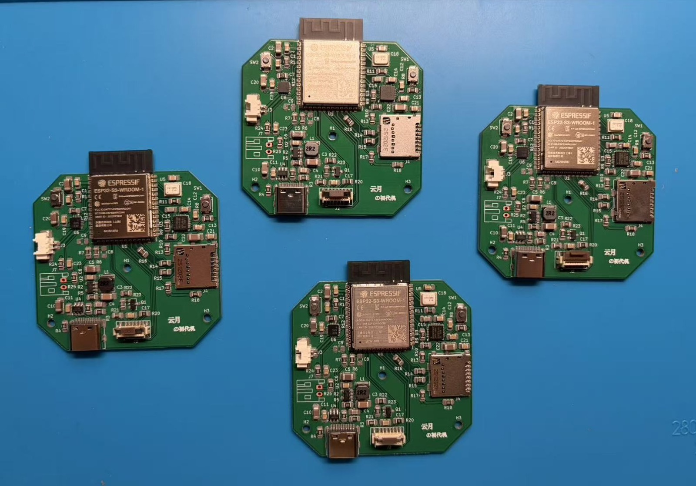
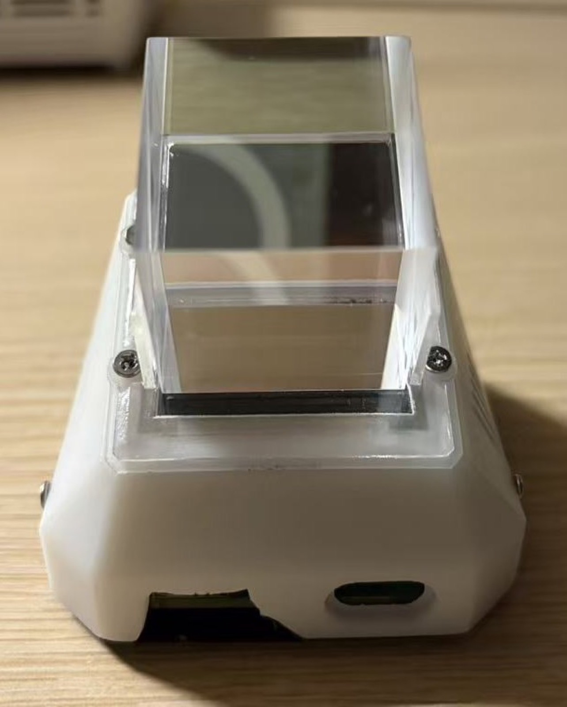

# VoxConductor 硬件与接线

最后更新：2026-10-11（保留 9 月 25 日确认的 GPIO 映射）

本文是开发时查阅的器件、引脚和电气说明。整体介绍、原理图、PCB、贴片前后照片、部件局部图和 3D 结构见 [硬件设计与装配](HARDWARE_DESIGN.md)。已有整机运行演示；下文检查顺序仍用于换板或重新装配后的验证。

当前固件面向定制 PCB，不再沿用开发板加模块的旧接线。下表来自已确认的 `VoxConductor.kicad_sch` 网络表；数字均为 GPIO 编号，不是 WROOM 模组封装脚号。

原型备份已单独保存。[原型 BOM](BOM.csv) 仅记录旧模块阶段；定制板请看 [电子 BOM](../hardware/BOM.md) 与逐位号明细。已有定制 PCB 整机演示，换板或改变装配后仍需重新检查，编译结果不替代电气验收。

## 1. 板载器件与配置

- 主控：ESP32-S3-WROOM-1。原理图未指定完整存储后缀，现有固件暂保留16MB Flash、八线PSRAM配置；烧录前核对实物是否为N16R8等匹配型号，不从“WROOM-1”推断容量。
- 显示：T154H7-C12-01 V2 / GMT154-01，240×240、ST7789系列、12P FPC。
- 麦克风：INMP441，L/R接地，左声道，16kHz采集。
- 功放：MAX98357A，5V供电，SD_MODE经板载电阻上拉，GAIN_SLOT悬空，无软件关断引脚。
- IMU：原理图MPU6050；驱动仍兼容WHO_AM_I为0x68的MPU6050和0x70的MPU6500。
- 存储：板载microSD卡座，SPI3，最高10MHz，FAT32；挂载失败不格式化。
- 按键：J7外接常开按键，板载上拉与RC滤波，低电平按下。

## 2. 定制PCB引脚表

| 外设 | 信号 | GPIO | 说明 |
| --- | --- | ---: | --- |
| 屏幕 | MOSI | 10 | SPI2 |
| 屏幕 | SCLK | 13 | SPI2 |
| 屏幕 | DC | 11 | 数据/命令 |
| 屏幕 | RST | 12 | 复位 |
| 背光 | BL | 9 | 经R22驱动Q1，输出高电平开启 |
| 麦克风 | SCK | 2 | I2S位时钟 |
| 麦克风 | WS | 1 | I2S左右时钟 |
| 麦克风 | SD | 42 | 数据输入，L/R接地 |
| 功放 | BCLK | 5 | I2S位时钟 |
| 功放 | LRC | 6 | I2S左右时钟 |
| 功放 | DIN | 4 | 数据输出 |
| microSD | CS | 48 | 片选 |
| microSD | SCK | 21 | 时钟经R16到卡座 |
| microSD | MOSI | 47 | 主控到卡 |
| microSD | MISO | 14 | 卡到主控 |
| 用户按键 | KEY_USER1 | 16 | J7经R25，按下接地 |
| MPU | SDA | 39 | I²C，板载上拉 |
| MPU | SCL | 40 | I²C，板载上拉 |
| MPU | INT | 41 | 原理图已连接；当前轮询驱动不配置中断 |

屏幕J2第8脚CS经R20接地，显示独占SPI2，软件仍设CS=-1。GPIO19/20保留原生USB；GPIO0为BOOT，不作为用户按键。GPIO35～37不用于外设，以免与八线PSRAM冲突。

## 3. 驱动配置与板级适配

- `app_display.c`：迁移四个SPI控制/数据引脚，增加GPIO9背光。先关背光，面板和LVGL初始化成功后开启，失败路径不主动点亮；当前已接入 LEDC/PWM 亮度调节。
- `app_audio.c`：迁移麦克风与功放两组I2S引脚。保留左声道采集与左右槽复制播放；软件音量可调，实际值以设备配置为准。播放保持24kHz，声学回声参考单独转换为16kHz。
- `app_storage.c`：迁移SD四线，保持SPI3、10MHz及不自动格式化策略。
- `app_button.c`：迁移到GPIO16，保留10ms独立采样、连续3次稳定消抖、500ms长按和忙时短按取消。
- `app_motion.h`：SDA/SCL改为39/40。AD0接地，预期I²C地址0x68；保留Y轴和方向1，需按实际安装核对左右方向。

显示使用 SPI mode 3、40 MHz。2026-09-25 根据外壳/棱镜中倒置的实拍画面，方向调整为 `mirror_x=true / mirror_y=false`，相对此前旋转 180°，Y 偏移从 80 改为 0。已有实物照片记录当前效果；更换屏幕或调整光路后，需要重新确认文字方向与可视边界，不在 UI 和驱动中重复镜像。

## 4. 构建与换板回归

主机回归（包含新板引脚映射和冲突检查）：

```sh
sh tests/run_cloud_checks.sh
```

需要重新与原理图比对时，用KiCad导出XML网络表，再运行：

```sh
python3 tests/test_board_pins.py /path/to/exported-netlist.xml
```

在VS Code打开 `firmware` 的ESP-IDF工程，编译后烧录。原生USB设备端口可能随新板改变，应重新选择；先退出串口监视器，避免占用端口。

按顺序验证：

1. 烧录前核对主控完整后缀与Flash/PSRAM配置。断电检查装配和连接器方向，供电先检查短路及电源轨；发现异常发热或电压异常立即断电。
2. 启动日志确认Flash/PSRAM初始化，无反复重启；屏幕日志应为MOSI=10、SCLK=13、DC=11、RST=12、BL=9，检查背光及完整画面。
3. 按键日志应为 GPIO16；单击进入/确认、双击返回，基础页以倾斜切换。长按超过 500 ms 录音、松开发送，语音忙时单击终止当前会话。
4. 麦克风日志SCK=2、WS=1、SD=42；功放日志BCLK=5、LRC=6、DIN=4。先用简短语音、低音量检查识别和播放，不用持续大音量信号测试。
5. 断电插入已备份的FAT32卡，启动确认挂载，再进行一轮对话并检查保存结果，不带电拔插。
6. MPU日志应为SDA=39、SCL=40、地址0x68；静置后左右倾斜分别翻页，方向不符按 [摇动翻页](MPU6050_GESTURES.md) 调整轴向/符号。
7. 最后按 [语音对话实施方案](VOICE_DIALOGUE_AND_MEMORY_PLAN.md) 回归天气、提醒、记忆与打断。

## 5. 电气边界

- MAX98357A为BTL输出，J3两脚只能接扬声器两端，任何一端不得接地。
- 麦克风、IMU、SD和屏幕逻辑电源按原理图使用3.3V域，不接5V；功放使用5V。禁止未隔离的双电源倒灌。
- 背光沿用Q1与10Ω限流电阻；GPIO只控制Q1基极，不直接供背光电流。实际电流、亮度和电源噪声需实测，不以软件高电平保证额定亮度。
- 固定扬声器与麦克风并避免结构振动耦合。当前接入唤醒词打断，但不能因编译通过或偶次命中即视为完成AEC调试。
- 每次换板、接口返修或结构变更后，重新核对电源、显示、音频、SD、按键及姿态输入；已有整机演示不替代新装配的回归。

## 6. 当前实物与组装资料

我已整理 [电路、PCB 与装配说明](HARDWARE_DESIGN.md)：包含设计导出、贴片前后实拍、部件全景，以及主板、屏幕、方形分光棱镜、透明支架、结构件、按键和扬声器的局部图。设计版本和实物验证分别标注。

<p align="center">
  
  
</p>

[查看高分辨率部件全景](images/2026-10-10/assembly-parts-overview.jpg)。原理图、PCB、制造文件及 V3-SLA 结构现已统一收录于 [hardware/](../hardware/README.md)；当前本机固件改动不随本次硬件资料发布。

## 7. 结构文件与当前修订

[V3-SLA 装配、打印与螺丝清单](../hardware/mechanical/V3-SLA/README.md)修复 USB 左右镜像和 PCB 装入柱位干涉。需成套替换主壳、底盖、扬声器托架；先打印入口框和底盖试装。CAD 检查通过，树脂实配待完成。

KiCad 源文件仍是 9 月投板状态，实物 J2 旋转返修尚未写回设计；生产文件不代表已包含该修正。详细边界见 [硬件设计入口](../hardware/README.md)。
