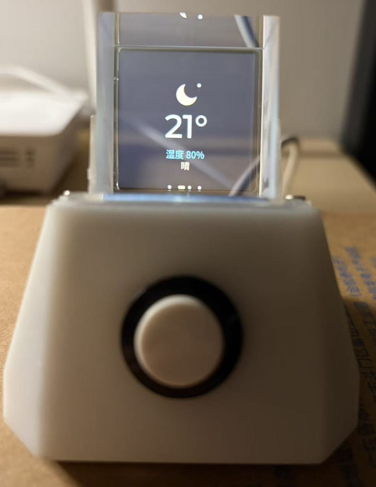
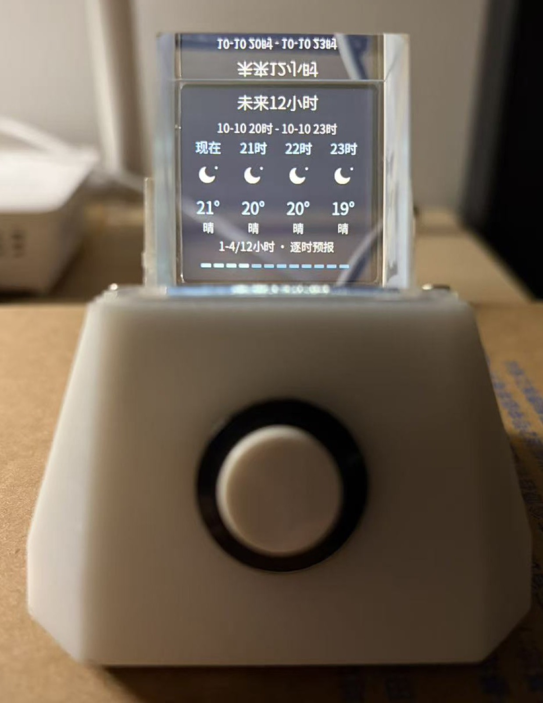
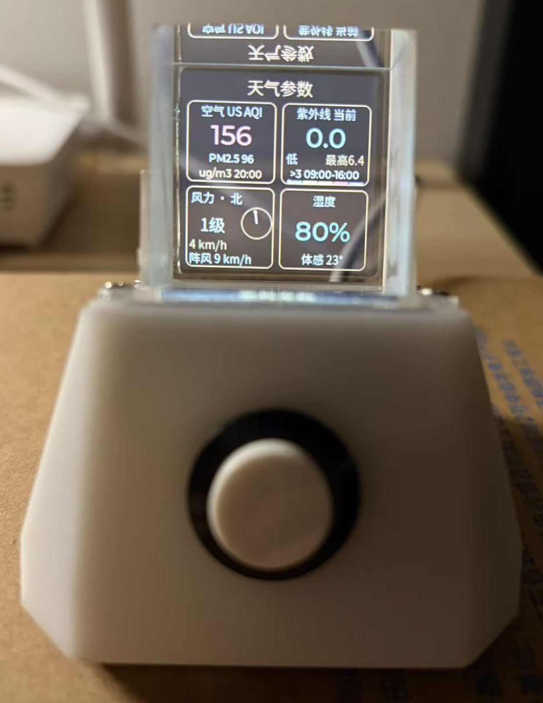
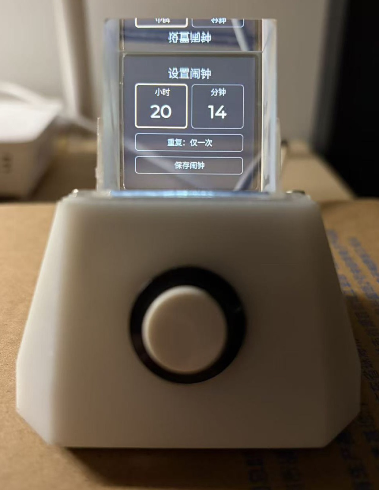
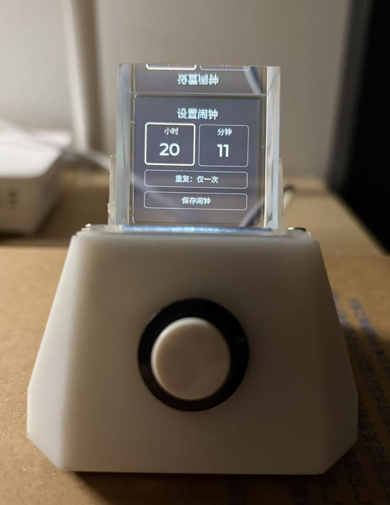
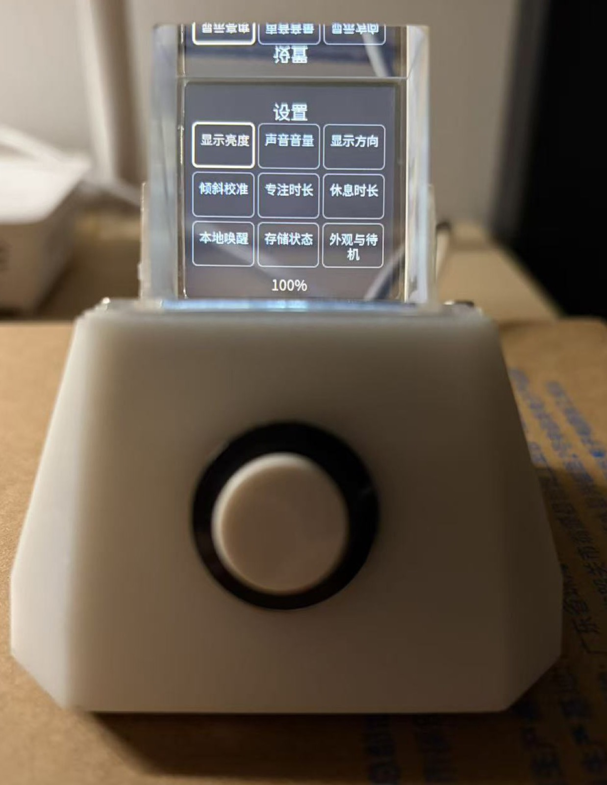
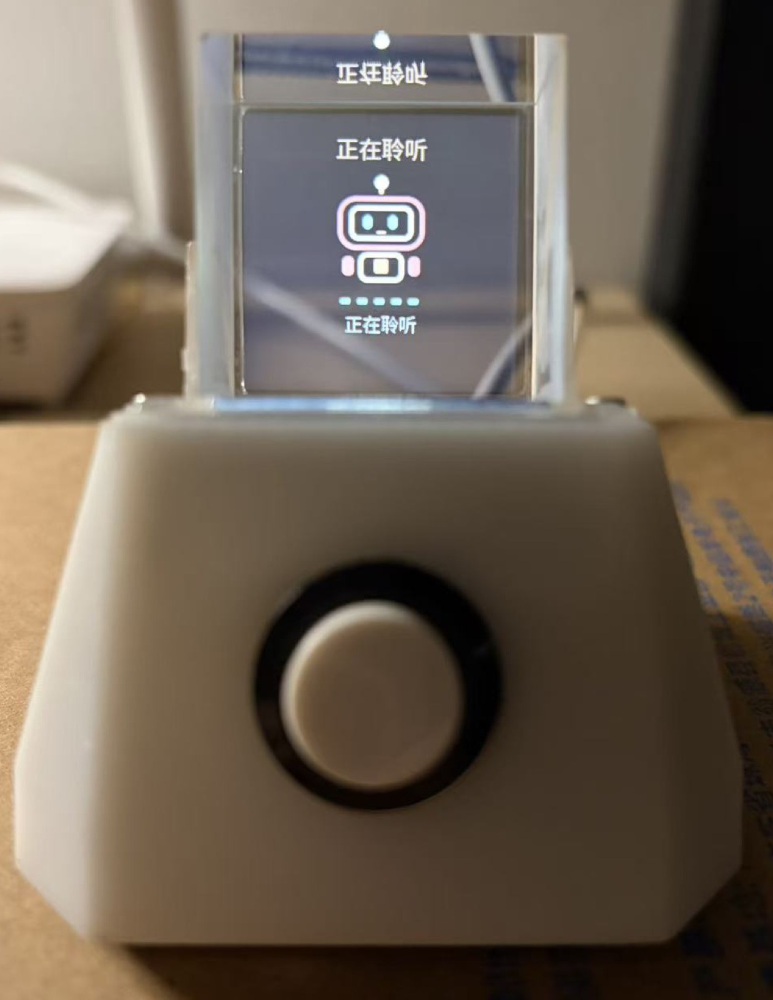
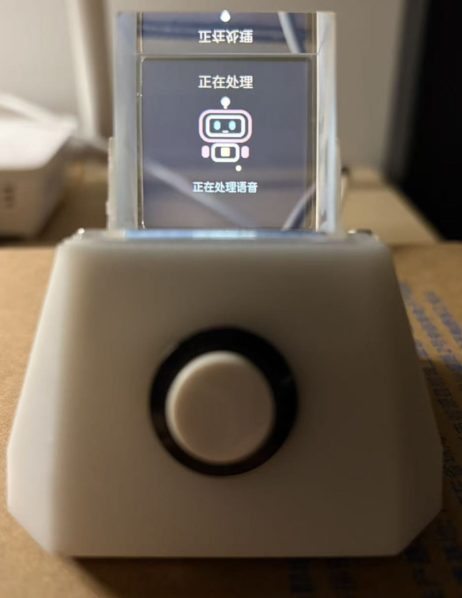
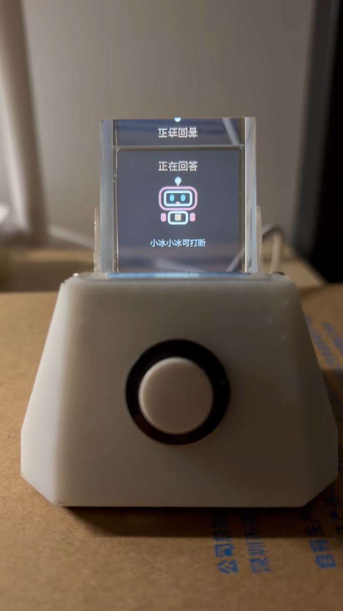
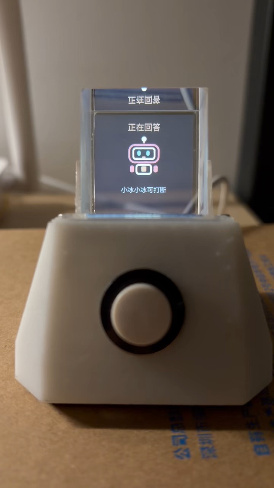

# 我的 VoxConductor：实物与功能演示

更新：2026-10-11。这里集中展示整机、组装与功能演示。照片从原图裁去多余背景；完整视频保留时间线，提问阶段音轨经过变调，封面直接取帧。[硬件设计与装配](HARDWARE_DESIGN.md) 和 [功能与页面](FEATURES.md) 分别提供详细说明。

我希望这些材料既能说明设备现在能做什么，也能让人看到从电路板、零件到桌面成品的过程。画面中的时间、天气与设置只代表拍摄当时的状态。

## 1. 整机与棱镜显示

  

我以黑底亮色界面配合棱镜反射，让时钟和信息呈现出悬浮观感。屏幕仍然是二维显示；棱镜不是实际三维全息投影器件。

  
  
  

这些角度记录外壳、棱镜和接口的相对位置；器件型号与引脚以 [硬件说明](HARDWARE_V1.md) 为准，不仅凭外观推断。

## 2. PCB 与组装部件

  
  

  

部件全景保留两个互补角度，页面使用裁边后的展示版，高分辨率原图另外保留：

- [正视全景](images/2026-10-11/assembly-parts-overview.jpg) · [另一角度](images/2026-10-11/assembly-parts-angle.jpg) · [高分辨率原图](images/2026-10-10/assembly-parts-overview.jpg)

照片可对应看到主板、显示组件、主壳、底盖、固定框、透明支架、按键与扬声器；黄色包装内的部件已确认为方形分光棱镜，并补充独立实拍。局部图及用途见 [装配部件](HARDWARE_DESIGN.md#4-装配部件每一部分负责什么)，元件明细见 [电子 BOM](../hardware/BOM.md)，工程文件见 [硬件目录](../hardware/README.md)。

## 3. 天气、预报与参数

  
  
  

当前天气、未来 12 小时预报和参数卡片是不同页面。小时预报可倾斜滚动，不要求一屏挤下全部 12 个时刻。参数页集中呈现空气质量、紫外线、风与湿度，UV 大于 3 的当日时段放在紫外线模块里。

空气质量采用 US AQI；这些是网络天气/空气质量数据，不是设备所在房间的实时检测值。

## 4. 闹钟与桌面设置

  
  
  

我把主页二级页收敛为闹钟设置。编辑时区分小时和分钟，倾斜幅度控制变化速度；设置集中在九宫格中，单击确认、双击返回，减少同一按键在不同页面承担互相冲突的操作。

  

入口图标只表示页面分类，不代表旧游戏仍在当前固件中。游戏已经备份并移除，现阶段我优先投入语音和桌面工具。

## 5. 一轮语音对话的界面

  
  
  

这组照片展示聆听、处理和回答三个状态。界面显示打断提示说明功能入口存在，不等于在所有声学环境下都能稳定触发；实际进展见 [语音说明](VOICE_DIALOGUE_AND_MEMORY_PLAN.md)。

## 6. 两段完整视频

### 唤醒并查询时间、天气

[完整过程，变调展示版，25.93 秒](videos/2026-10-10/wake-time-weather.mp4?raw=true) · [回答阶段节选，15.93 秒](videos/2026-10-10/wake-time-weather-answer-clip.mp4?raw=true)（拍摄时间线 00:10.00–00:25.93）。

我在这段视频中演示语音唤醒，以及查询时间、天气的交互。工具的实际数据来源和错误处理需要结合对应轮次日志核对，视频本身不展示全部内部调用过程。

### 语音调节设备音量

[完整过程，变调展示版，29.27 秒](videos/2026-10-10/voice-volume-control.mp4?raw=true) · [回答阶段节选，11.27 秒](videos/2026-10-10/voice-volume-answer-clip.mp4?raw=true)（拍摄时间线 00:18.00–00:29.27）。

我在这段视频中演示通过语音调整音量。正式回归还要比较设置值、实际播报音量和重启后的保存结果，不能只把助手说“完成了”作为验收标准。

完整视频的画面流未改变，提问阶段变调并补偿时长；设备回答阶段不主动变调，混合录音中的声音无法完全按说话者分离。回答节选保留此前连续区间，不加速、不补配音；它们不含完整操作过程，不能据此测量唤醒或回答延迟。处理范围见 [视频说明](videos/2026-10-10/README.md)，原名、校验值和取帧位置见 [素材清单](images/2026-10-10/manifest.json)。

## 7. 我还会补什么

- 同一段长回答的完整录音、对应固件版本与串口摘要，用于比较卡顿是否真正改善。
- 回答过程中唤醒词打断、新问题接续、只说唤醒词后保持安静的对照演示。
- 音量和主页切换的“操作前 → 操作后 → 重启回读”，以及闹钟到期实拍。
- 管理网页的 [手机/电脑模拟预览](WEB_MANAGEMENT_DESIGN.md#2-六区布局) 已补齐，后续增加设备实际运行、上传与保存回读演示。
- 现有 [硬件文件](../hardware/README.md) 继续补采购料号、J2 修订和 V3 实物试装记录。

我不会用功能照片代替可靠性测试。未来更新会继续保留遇到的问题及其验证结果，而不是只展示成功片段。
