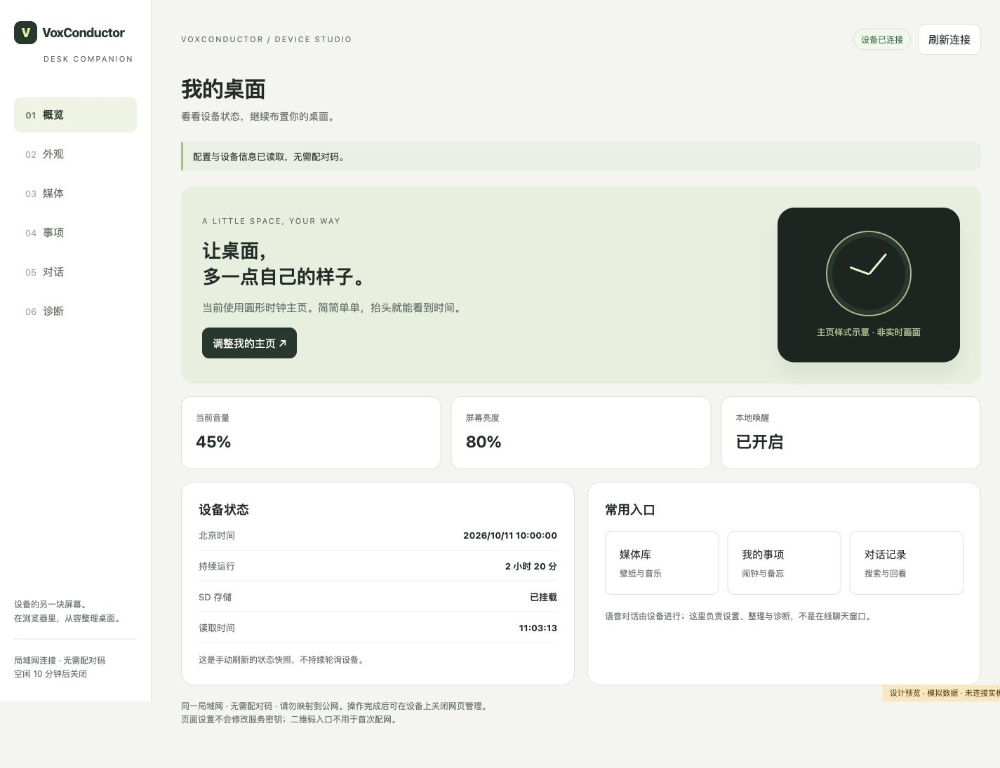
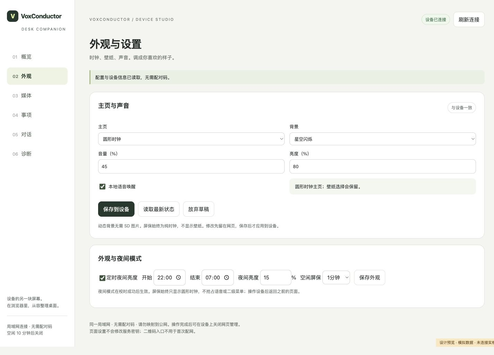

# 设备管理网页：布局、功能与验收

更新：2026-10-11。依据当前 `media_web.html`、`app_media_web.c` 与 `app_control.c`。六区页面及本轮状态、回执和传输改进已通过主机检查与固件编译；本次没有烧录设备。最新固件代码另行整理发布。

## 1. 网页应该负责什么

我将网页定位为设备的整理入口：大屏适合输入名称、管理文件、查记录和下载诊断；设备仍负责日常显示、姿态操作、采音、播放与语音对话。网页不是另一个聊天应用，也不另建一套任务数据库。

| 放到网页 | 留在设备 | 暂不加入 |
| --- | --- | --- |
| 状态、主页、音量、亮度、唤醒开关 | 唤醒、采音、播放、按键取消 | 网页云端聊天、实时屏幕投送 |
| 图片/音频上传、转换与文件整理 | 日常音乐、壁纸和信息显示 | 任意 SD 路径访问、常驻录音 |
| 闹钟日期、任务名称、纪念日 | 倾斜快速调节、到期提醒 | 公网账号、多用户和社交功能 |
| 当前卷历史、手动声学诊断 | 姿态校准和实体操作 | 没有后端支持的 OTA/首次配网按钮 |

## 2. 六区布局

电脑采用左侧导航，手机采用底部导航。浅灰底、白色卡片、深绿主按钮，黑底只用于主页示意。每次只展示当前区域，减少长页面里的信息竞争。

| 区域 | 当前内容 |
| --- | --- |
| 概览 | 已读取的主页、音量、亮度、唤醒开关、北京时间、运行时间、SD 状态与快捷入口 |
| 外观 | 主页类型、静态/动态背景、音量、亮度、唤醒；夜间亮度与纯时钟屏保 |
| 媒体 | 图片预览与 RGB565 转换、音频转 WAV、文件列表、播放/循环/定时、素材包安装 |
| 事项 | 闹钟/待办/备忘录分类、8 条共享容量、稳定编号、编辑与状态操作；纪念日折叠区 |
| 对话 | 当前文字卷的关键词查询、三条分页、原文片段按需展开 |
| 诊断 | 内部 RAM、最大连续块、PSRAM；空闲唤醒与回答中打断的手动采集 |

| 外观设置 | 手机端概览 |
| --- | --- |
|  |  |

以上是本机浏览器中运行真实页面、模拟接口数据的截图，不是已刷入 ESP32 的运行证据。主页图形是样式示意，不是实时截屏。

[事项页面模拟预览](images/2026-10-11/web-tasks-desktop.jpg) 展示独立读取按钮、共享容量、稳定编号和分类操作。

## 3. 这轮实际改进

### 连接与反馈

无需配对码。设备先联网并开启管理窗口，手机/电脑处在可访问设备的同一局域网，再通过二维码或 IP 打开页面。管理空闲 10 分钟关闭；页面不持续轮询或发送心跳，避免无操作时长期续期。

“刷新连接”更新媒体目录与基本状态；“读取最新状态”仅读取 RAM 快照，不查询任务和历史文件。事项单独提供读取按钮，经轮次协调者在设备空闲时执行。传输仍使用单个 HTTP 处理任务，长文件传输期间其他 HTTP 请求可能等待，不能把轻量读取理解为随时无延迟。

连接中断、窗口过期、请求失败显示可执行的提示；操作忙时说明已有请求，不悄悄丢掉点击。导航仍可切换，写操作串行，结果未知时先查询已有编号，不自动重复执行。

### 外观与声音

- 编辑只形成网页草稿，保存才写设备；未保存项有明确提示，切页不丢草稿。
- 读取状态保留正在编辑的字段，未编辑字段跟随设备更新。
- 保存前先读最新五项配置，只合并本次改动，减少旧快照覆盖其他设置的情况。
- 保存后查询作业结果并再次读回实际值；提交值与回读不符时提示检查，不仅显示“已提交”。
- 音量、亮度限制为 0–100 的整数；“放弃草稿”恢复最近读到的值，不写设备。
- 主页与背景分开保存，可以直接切回圆形时钟。屏保始终是无壁纸时钟。

读取与写入之间仍不是原子版本更新，多端同时修改时仍有竞争；后续应增加受限字段更新和版本号校验，而不是宣称已经解决所有并发情况。

### 媒体、事项与记录

图片的压黑效果同时用于预览和 RGB565 输出。上传显示浏览器传输进度，等待设备校验、提交并返回 HTTP 成功后才提示完成。新增“取消上传”：终止浏览器请求并停止后续批量文件，后端保留未提交文件清理与旧文件恢复机制。若取消时已完成提交，新文件可能仍存在，页面明确要求刷新核对，不承诺撤回。

浏览器音频试听直接使用媒体 URL，后端支持单段 HTTP Range；不再先将整段音频下载到 JavaScript Blob 后才能播放。实际浏览器仍可能自行预载，不宣称只下载某个固定大小。

图片选择、媒体控制、夜间外观和纪念日命令均使用有界回执，分别报告接受、应用和保存结果。播放命令成功只表示播放设置已应用，不等于文件已完整播放。设为壁纸先确认文件选择，再将主页切为 SD 图片样式；若后一阶段失败，会显示错误而不隐去前一阶段已生效的事实。

事项提供分类筛选、容量计数和稳定编号；时间明确按北京时间，日期合法性在前端检查，设备继续负责范围与业务校验。非闹钟不提供循环设置。纪念日读取保留未保存字段，未编辑项同步设备更新；保存后按实际回读更新，不再只能重新打开页面读取。

对话仍查询当前卷，每页最多三条，封存卷离线查看。原文以安全文本插入，不把记录当 HTML 执行；“生成过的回答”与“完整播放过”不等同。

诊断区默认折叠，点击后才采集；语音唤醒开关不等于模型就绪检测。现有状态接口没有返回固件版本、RSSI 和模型失败原因，页面不虚构这些数值。

## 4. 接口与保留的限制

| 接口 | 当前用途 |
| --- | --- |
| `GET /api/catalog` | 媒体目录、播放状态、外观与纪念日 |
| `GET /api/state` | 只读 RAM 快照：时间、网络、内存与五项配置，不读取历史文件 |
| `POST /api/command` + `GET /api/media-job?id=…` | 媒体、外观和纪念日提交与实际执行回执，最多四个有限回执槽 |
| `POST /api/device` + `GET /api/job?id=…` | 配置、任务及历史的单槽有界作业；完整状态包含任务与存储信息 |
| 文件 GET/PUT/DELETE | 受限媒体目录；GET 支持单段 Range，PUT 保留事务替换 |
| 唤醒/打断诊断接口 | 手动采集、状态与有限音频下载 |

设备控制共用单个作业槽，语音忙时可能等待。媒体回执也是有限容量，旧编号可能失效；结果未知先核对当前状态，不自动重放。临时播放/暂停与定时设置的回执不是重启后持久保存保证。

文件传输仍走现有 HTTP 处理路径，没有新增异步传输任务、分块断点续传或跨卷历史搜索。上传取消只作用于浏览器正在进行的传输；素材包“继续上传”只在本页内存中记住已传文件，刷新页面后不会恢复这个进度。

管理仍是同网 HTTP，无配对码。不要映射到公网；使用完可在设备上关闭窗口。网页不读取或修改云服务密钥，二维码也不是首次 Wi-Fi 配网入口。

## 5. 已检查与还要测试的内容

主机检查覆盖现有上传/WAV 约束、草稿刷新保留、外部更新合并、保存回读、错误提示、非法数值拒绝、任务/北京时间、历史分页与安全文本渲染。浏览器用模拟接口检查电脑布局和 390 像素手机布局，以及设置保存、事项筛选、历史、诊断入口。

本轮固件已编译通过，尚未烧录或完成网页实机验收。烧录后的最小回归：

1. 手机扫码打开，无配对码；电脑和手机六区可用，无横向溢出。
2. 改音量但不保存，刷新仍保留草稿；保存后设备与网页一致，重启后核对保存值。
3. 切成壁纸 + 数字时间，再切回圆形时钟；屏保始终不显示壁纸。
4. 创建/编辑闹钟、待办、备忘录，检查分类、编号、北京时间和实际到期。
5. 上传一张图片、一段短音频，验证预览、进度、取消、同名覆盖；浏览器试听和拖动进度后仍能播放。
6. 语音忙、缺卡、断网、管理窗口过期时不误报成功；未知作业结果先查询，不重复写入。
7. 查询历史与手动诊断；不采集时不会自动下载或上传录音。

## 6. 后续完善顺序

轻量快照、媒体回执、上传取消与单段 Range 已接入。下一阶段先做本轮实机验收，再按实际传输阻塞证据决定是否需要独立传输槽；之后整理历史轮次与受限导出。固件版本、网络信号、模型就绪和最近错误必须来自真实设备字段。

OTA、首次配网和公网管理是独立项目，不能作为页面美化顺便加入。当前保持单设备、同网、轻量 HTML/CSS/JavaScript，不引入前端框架或账号系统。

[功能总览](FEATURES.md) · [后续计划](ROADMAP.md) · [文档导航](README.md)
